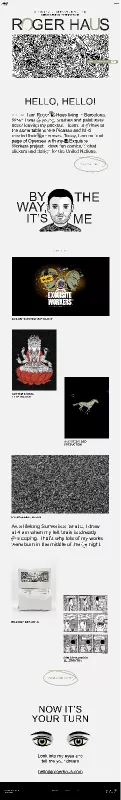

# Roger Haus — Illustrator & Art Director Portfolio (32-Amaliy Ish)

Figma dizaynining yuqori aniqlikdagi (**Pixel-Perfect**) to'liq, zamonaviy, interaktiv va to'liq moslashuvchan (fully responsive) illyustrator, art-direktor va syurrealizm rassomi veb-platformasi: **Roger Haus — Master Design System (node-id: 0:1)**.

[-F24E1E?logo=figma&logoColor=white)](https://www.figma.com/file/OPWShg4RkQ8vZRclaKpegG/Roger-Haus?type=design&node-id=0%3A1&mode=design&t=QDH3aMzLag88bHLl-1)
[](https://developer.mozilla.org/en-US/docs/Web/HTML)
[](https://developer.mozilla.org/en-US/docs/Web/CSS)
[](https://developer.mozilla.org/en-US/docs/Web/JavaScript)
[](https://developer.mozilla.org/en-US/docs/Learn/CSS/CSS_layout/Responsive_Design)
[](https://vercel.com/)

---

## 📸 Figma Dizayn Ko'rinishi (Master Canvas)



---

## 📌 Loyiha Haqida

Ushbu loyiha Figma platformasidagi **Roger Haus — Illustrator & Art Director** dizaynining to'liq ekotizimi va dizayn tokenlari (node-id: `0:1`) asosida 100% aniqlik bilan ishlab chiqildi. Sayt xalqaro miqyosda e'tirof etilgan, Barselonada yashovchi va ijod qiluvchi taniqli syurrealist illyustrator hamda raqamli san'atkor **Roger Haus**ning shaxsiy portfolio platformasidir.

- **Figma Manzili**: [Roger Haus — node-id: 0:1](https://www.figma.com/file/OPWShg4RkQ8vZRclaKpegG/Roger-Haus?type=design&node-id=0%3A1&mode=design&t=QDH3aMzLag88bHLl-1)
- **Topshiriq**: 32-Amaliy Ish
- **GitHub Repozitoriyasi**: [https://github.com/soxibs48-eng/amaliy32](https://github.com/soxibs48-eng/amaliy32)

---

## ✨ Asosiy Sahifalar va Imkoniyatlar

Loyiha Figma dizaynidagi barcha asosiy bloklar va bo'limlarni hamda to'liq ko'p sahifali navigatsiyani qamrab olgan:

### 1. 🏠 Asosiy Bosh Sahifa (`index.html`):
- **Header & Navbar**:
  - Maxsus mualliflik monogramma logotipi (`RH` va syurreal mushuk quloqlari).
  - *"Illustrator & Art Director Living in Barcelona"* sarlavhasi.
  - Sahifalararo navigatsiya (Works, About, Contact).
  - Mobil qurilmalar uchun moslashuvchan interaktiv gamburger menyu drawer.
- **Hero Banner**:
  - Katta massiv brend tipografiyasi: **ROGER HAUS** (Maxsus 'O' harfida yarim oy zaytun gardishi va 'U' harfida pastki rangli tushirish effekti bilan).
  - Intricate Cadavre Exquis / Hypnagogia qora-oq chizma pannosi.
  - Interaktiv suzuvchi stiker: *"DROP YOUR LETTER ✉"*, bosilganda elektron pochta nusxalanadi va xat oynasi ochiladi.
- **"HELLO, HELLO!" Bo'limi**:
  - *"HELLO, HELLO!"* yirik sarlavhasi.
  - Muallifning badiiy manifesti: Barselona, yoshlik chog'laridan boshlangan chizmachilik ehtirosi, buyuk **Pikasso** va **Miro** ta'lim olgan tarixiy **La Llotja** san'at akademiyasidagi ta'limi, **OpenSea** bosh sahifasidagi **Exquisite Workers** loyihasi hamda **BMT (United Nations)** uchun yaratilgan stikerlar.
  - Qo'lda chizilgan oval konturli interaktiv tugma: *"TELL ME MORE"*.
- **"BY THE WAY, IT'S ME" Bo'limi**:
  - Markazda Roger Hausning qo'lda chizilgan o'ziga xos portret illyustratsiyasi.
  - Chap va o'ng tomonga bo'lingan katta tipografik sarlavha: `BY [portret] THE` / `WAY, [portret] IT'S ME`.
  - Pastki bo'luvchi qator: `— SELECTED WORKS —`.
- **Selected Works (Tanlangan Asarlar Galereyasi)**:
  - Interaktiv toifalar filtri: `[ ALL ]`, `[ SURREALISM ]`, `[ NFT / OPENSEA ]`, `[ EDITIONS & PRINTS ]`, `[ COMICS ]`.
  - **1. EXQUISITE WORKERS™**: OpenSea bosh sahifasidagi 500+ global ijodkorlar bilan birga o'tkazilgan syurreal loyiha.
  - **2. LOTUS GODDESS**: Qizil nilufar guli ustida o'tirgan ko'p qo'lli ilohiy syurreal xilqat (1 of 1 Drop).
  - **3. COSMIC STEED**: Fazoda yelib borayotgan oltin rangli samoviy tulpor (Animatsiya va harakat yo'nalishi).
  - **4. HYPNAGOGIAS SERIES**: Tun yarmi (soat 3:00–5:00)da ongsiz chizilgan o'n minglab chiziqlardan iborat katta master asar.
  - **Badiiy Iqtibos Bloki**: *"As a lifelong Surrealism fanatic, I draw at 4 am when my left brain is already sleeping. That's why lots of my works were born in the middle of the night."*
  - **5. ROGER HAUS MONOGRAPH**: Cheklangan nashr (100 nusxa) maxsus kitob-qutisi.
  - **6. ONE MORE COMIC FOR THE TRIP**: 6 kvadratli syurreal mini-komiks chizmasi.
  - Har bir kartani bosganda modal dialogida to'liq tavsif, teglari va kattalashtirilgan ko'rinishi ochiladi.
  - Qo'lda chizilgan shakldagi *"VIEW ALL WORKS"* harakat tugmasi.
- **"NOW IT'S YOUR TURN" Aloqa Bo'limi**:
  - Katta sarlavha: *"NOW IT'S YOUR TURN"*.
  - **Sehrli Interaktiv Ko'zlar (SVG Eye-Tracking Engine)**: Foydalanuvchi kursorining butun ekran bo'ylab harakatiga qarab qorachiqlar silliq burilib kuzatib boradi!
  - *"Look into my eyes and tell me your dreams"* chaqirig'i.
  - Katta chizilgan interaktiv havola: `hello@rogerhaus.com` (bosganda to'g'ridan-to'g'ri nusxalash va avtomatik bildirishnoma ko'rsatiladi).
- **Footer**:
  - Mualliflik huquqi `© 2021–2026 ROGER HAUS. ALL RIGHTS RESERVED.`
  - Navigatsiya havolalari (Works, About, Contact, Shop).
  - Ijtimoiy tarmoqlar (Instagram, Twitter, Behance, OpenSea).

---

### 2. 📖 Qo'shimcha Sahifalar:
- **`about.html`**: Roger Hausning to'liq ijodiy biografiyasi, La Llotja tarixi, erishilgan xalqaro mukofotlar (Awwwards Honorable Mention, CSS Design Awards Special Kudos), ko'rgazmalar xronologiyasi.
- **`works.html`**: Barcha asarlar arxivi, toifalar bo'yicha saralash, "Girl with the Black Cat" kabi xalqaro virusli asarlar ko'rinishi.
- **`contact.html`**: Yangi art-direksiya, illyustratsiya va shaxsiy buyurtmalar uchun to'liq interaktiv shakl.
- **`404.html`**: Dizayn uslubiga moslashtirilgan syurrealist xato sahifasi.

---

## 🛠 Texnologiyalar Steki

- **HTML5**: Semantik, qulay (WAI-ARIA) va SEO uchun optimallashgan teglash tizimi.
- **CSS3**: Maxsus dizayn tokenlari, CSS Grid, Flexbox, Fluid Typography (`clamp`), brutalist chegara soyalari (`box-shadow`), qo'lda chizilgan irregular chegaralar.
- **Vanilla JavaScript (ES6+)**:
  - `initEyeTracking()` — Kursor va sensorli ekran harakatini real vaqt rejimida hisoblab, SVG ko'z qorachiqlarini aylantiruvchi matematika tizimi.
  - `initArtworkModal()` — Asarlarning to'liq o'lchamli Lightbox ko'rinishi.
  - `initCopyEmail()` — Pochtani clipboard ga nusxalab, silliq bildirishnoma (Toast) chiqarish.
  - `initPortfolioFilters()` — Galereya asarlarini dinamik filtrlash.
  - `initMobileMenu()` — Mobil menyu ochilishi va yopilishi.
- **Vercel**: `vercel.json` orqali toza URL manzillari bilan global joylashtirishga tayyor.

---

## 📁 Loyiha Strukturasi

```text
amaliy32/
├── assets/
│   ├── logo.svg
│   ├── portrait.svg
│   ├── eyes.svg
│   ├── hypnagogia-hero.png
│   ├── exquisite-workers.png
│   ├── lotus-goddess.png
│   ├── cosmic-steed.png
│   ├── hypnagogia-large.png
│   ├── art-book.png
│   ├── comic-strip.png
│   └── girl-black-cat.png
├── css/
│   └── styles.css
├── js/
│   └── main.js
├── index.html
├── about.html
├── works.html
├── contact.html
├── 404.html
├── figma_preview.png
├── vercel.json
├── .gitignore
└── README.md
```

---

## 🚀 Ishga Tushirish

Loyihani brauzerda ochish uchun:
```bash
# Har qanday lokal server orqali ishga tushirish (masalan Live Server yoki Python)
python -m http.server 8000
```
Keyin brauzerda `http://localhost:8000` manziliga kiring.

Muallif: **soxibs48-eng**
Topshiriq: **32-Amaliy Ish**
Figma: **Roger Haus (node-id: 0:1)**
